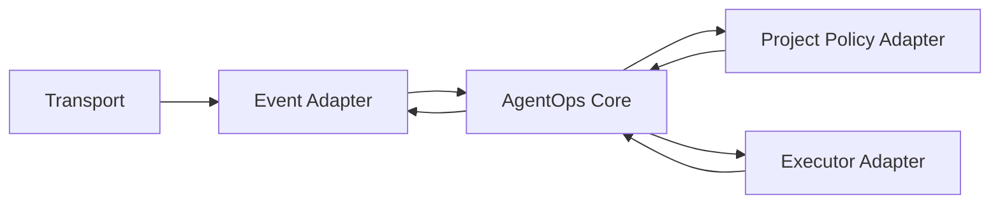

# Architecture

The public lighthouse distributes a versioned standard and offline reference code.
A separately implemented runtime executes it. Each consumer controls its own
identities, permissions, providers, resources, budgets, and adoption record.

## Four independent components

1. **AgentOps Core** records events/tasks, correlation, deduplication, claims,
   leases/fencing, attempts, aggregate budgets, cancellation, evidence, incidents,
   outbox, review and closure. It contains no provider SDK or transport-specific
   permission assumptions.
2. **Event Adapter** authenticates delivery, resolves authoritative resource revision,
   minimizes context, normalizes events and publishes authorized output with readback.
   A GitHub adapter is one reference design; other message brokers, APIs or local
   transports can implement the same port.
3. **Executor Adapter** declares capabilities and starts/polls/cancels bounded new
   executions, returning typed attempts, evidence and results. A Codex adapter is
   one reference design; other agent runtimes or deterministic tools are possible.
   A mention or event never implies an existing desktop session has awakened.
4. **Project Policy Adapter** loads adopted policy and a trusted identity registry,
   evaluates scope, verifies decisions, and issues/consumes/revokes grants. Public
   standard text is not a live source of project permissions.

Representative ports: ingest, evaluate, claim, heartbeat, start, poll, cancel,
submit_result, prepare_publication, apply_response and reconcile. Trust proofs are
constructed by trusted adapters, never deserialized as authority from message fields.

## Small implementation path

Start with a single-writer CLI and durable SQLite. Workers receive input snapshots
with read-only permissions; a separate publisher receives exact authorized output.
Transactions connect claims, budget/use reservations and outbox creation. Record
failed attempts and uncertain effects rather than erasing them on retry.

`agentops_reference/ledger.sql` is proposed DDL with local in-memory constraint tests.
It is not a complete durable worker. Persistent jobs, migrations, process races,
crash recovery, credential isolation and remote effects need real implementation
and evidence before they can be called conformant.

An ephemeral runner's database or cache is not durable state. Any hosted mode must
approve and test a consistent state store and checkpoints before starting effects.
Do not introduce broad repository write permission merely to avoid designing storage;
make that tradeoff explicit in the consumer's policy. The lighthouse hosts no private ledger.

Teams may share administration while using separate roles/jobs. That demonstrates
logical coordination, not independent administrative trust boundaries. Required
human acceptance remains separate from an automated technical assessment.

The [persistent runtime experiment](../experimental/PERSISTENT_RUNTIME.md) refines
the implementation path and its fault oracles. It explicitly requires exclusion
across overlapping resources, including different tasks, and action settlement within
one operator. This specification is not evidence of an implemented runtime.
